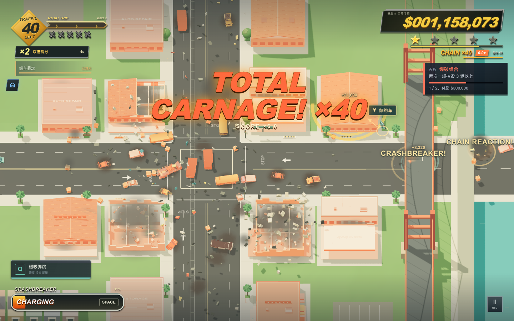
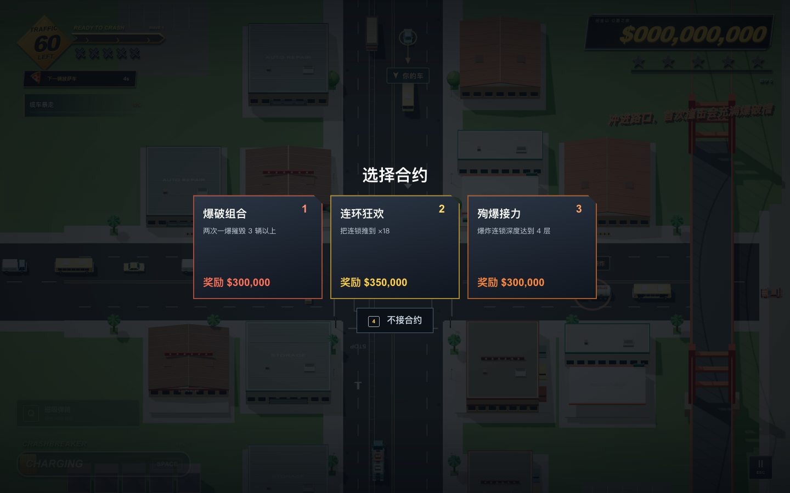
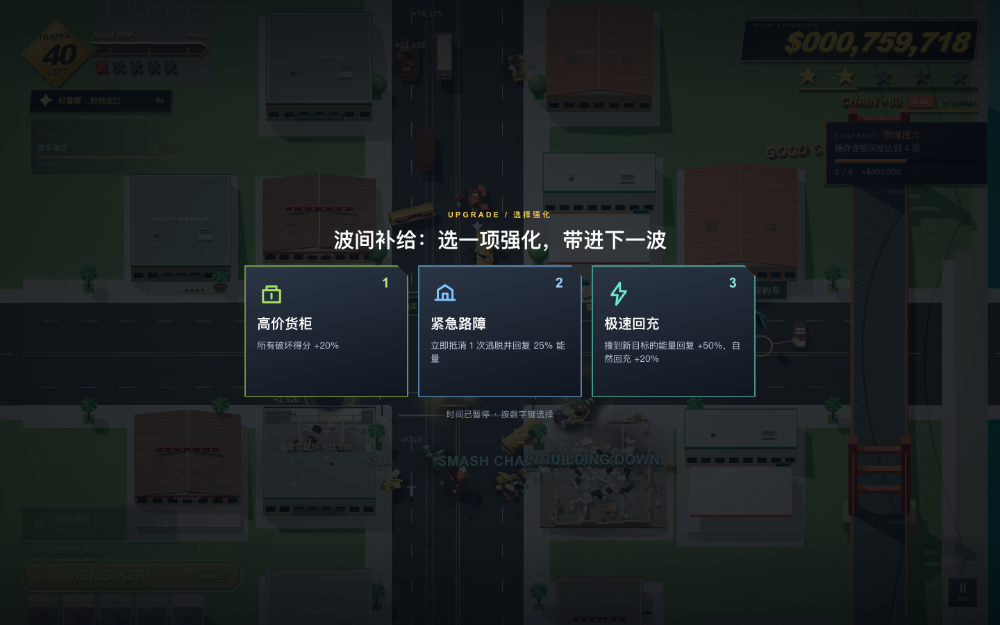
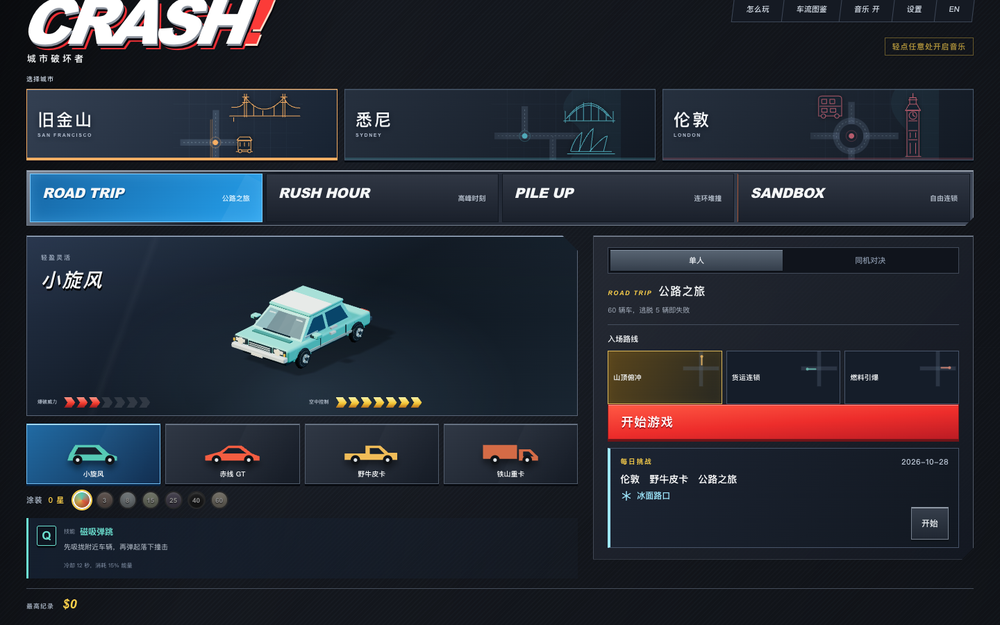
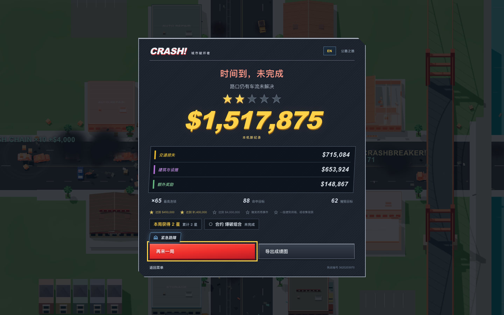
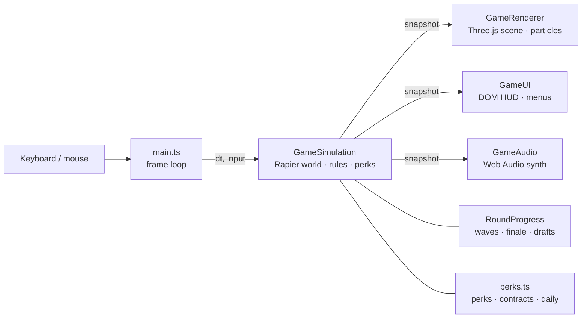

<div align="center">


# CRASH! City Breakers

**A browser arcade game about driving into an intersection, blowing yourself up, and steering the wreck into a bigger chain reaction.**

Inspired by *Burnout CRASH!*, rebuilt from scratch with Three.js and Rapier physics. Three cities, 23 vehicle types, four rulesets, perk drafts, contracts and a daily challenge.

[**▶ Play online**](https://crash-city-breakers.vercel.app) · [Features](#features) · [How it works](#how-it-works) · [Get started](#get-started) · [Development](#local-development)

**English** · [简体中文](README.zh-CN.md)


</div>

<br>



<br>

## Why it's worth a look

| | |
|---|---|
| **Every crash is physics** | All 23 vehicles, crates, lamps, trailers and buildings are Rapier rigid bodies. A bus tips because its centre of mass is high, not because a script says so. |
| **Every run is different** | Three perk drafts per run, an optional contract, a seeded reward bag and a daily twist. Same seed, same run — share the challenge number. |
| **Three real road layouts** | San Francisco's sloped crossroads, Sydney's offset T-junctions and London's roundabout each move traffic differently. |
| **Zero backend** | Static Vite build. Records, settings and paint unlocks live in `localStorage`; there is no account and nothing is uploaded. |

<br>

## Features

### Pick a contract, then draft perks between waves

<table><tr>
<td width="50%"></td>
<td width="50%"></td>
</tr><tr>
<td>Before launch, choose one of three <b>contracts</b> (collapse 3 buildings, reach a ×18 chain, zero escapes…) or skip. Completing it pays $250k–$500k and an extra star.</td>
<td>After each wave you draft one of three <b>perks</b> from a pool of nine: wider blast, heavier warhead, faster recharge, ember fuses, cheaper abilities… Time stops while you choose.</td>
</tr></table>

### Four rulesets, three cities, four player cars

| Ruleset | Limit | Finale |
|---|---|---|
| **Road Trip** | 60 vehicles in three waves; five intact escapes end the run | Route-specific disaster (tornado, air strike, tidal wave), stronger with fewer escapes |
| **Rush Hour** | 90 seconds; escapes are free | Super Crashbreaker at your position, then physics settles |
| **Pile Up** | 30 vehicles | Inferno: burning wrecks extend the clock, new destruction extends it more |
| **Sandbox** | 120 seconds, custom loadout | Three manual interventions (green wave, cargo drop, billboard) |

Each city has three approach routes and a city event you charge by crashing in a marked zone. Each player car has a **Q ability**: Magnet Bounce, Triple Pierce, Wreck Pitcher or Broadside Slam.

### Daily challenge with a twist



Today's date fixes the city, route, car, ruleset and one **mutator**: Tanker Riot, Icy Streets, Overdrive Traffic, Glass Cannon, Lunar Gravity or Gold Convoy. Everyone playing the same day gets the same seed. Your best score and streak are tracked locally.

### Feedback that lands

A 70 ms hit-stop on every Crashbreaker. At chain ×8 / ×16 / ×25 / ×40 the game slows down and shouts `NICE CHAIN!` → `TOTAL CARNAGE!` with a shockwave ring and a synthesized stinger. The chain multiplier badge sits next to your score. Stars earned across runs unlock six body paints.



### Built for phones

Landscape touch controls (a thumb-stick on the left, Crashbreaker and the ability on the right), a safe-area aware HUD, a sticky **Start** bar on the menu, and a **title-screen theme** you hear from the first tap: a seamless 16-bar loop in E Mixolydian at 126 BPM, in the spirit of Burnout CRASH!'s 80s new-wave game-show soundtrack, but original. It is synthesised from arithmetic with the [claude-code-music](https://github.com/yiqiao-yin/claude-code-music) framework, with no samples and no recordings.

This `main` branch is the plain web edition. The `toy-edition` branch adds the B站 Toy SDK: leaderboards, a cloud save and an album-ready score card.

<br>

## How it works



The simulation owns all state and steps Rapier at a fixed 60 Hz. Each frame it publishes an immutable **snapshot**; the renderer, HUD and audio only read it. Randomness is split into seeded streams (traffic, physics scatter, rewards, drafts, mutators) so one seed replays one run, and scripted tests never open a draft.

<details>
<summary>Project layout</summary>

```
src/
├── main.ts                 frame loop, input, persistence, hit-stop
├── shared.ts               vehicle table, routes, types, seeded RNG
├── cities.ts               three city layouts, lanes, event zones
├── i18n.ts                 Chinese → English copy table
├── simulation/
│   ├── GameSimulation.ts   Rapier world, collisions, abilities, features
│   ├── roundProgress.ts    traffic ledger, waves, finale, draft timing
│   ├── perks.ts            perks, contracts, mutators, daily seed, paints
│   ├── rules.ts            scoring, stars, record keys
│   ├── trafficPlan.ts      seeded arrivals
│   └── bonusPlan.ts        seeded pizza reward bag
├── render/                 Three.js renderer, procedural models, paint
├── ui/                     DOM HUD, garage, results, car preview
└── audio/                  Web Audio synthesizer
public/models/              55 GLB assets built by scripts/build-assets.mjs
tests/                      Vitest: rules, physics, bonuses, perks
scripts/                    asset build + Playwright browser checks
```

</details>

<br>

## Get started

### Play online

Open **[https://crash-city-breakers.vercel.app](https://crash-city-breakers.vercel.app)** in a desktop browser with WebGL 2. Nothing to install.

### Controls

| Key | Action |
|---|---|
| `W A S D` / arrows | Steer on approach; aftertouch the wreck after a blast |
| Mouse + `Space` | Aim and fire Crashbreaker when the meter is full |
| `Q` | Vehicle ability (needs cooldown + charge) |
| `1` `2` `3` | Pick a perk or contract · `4` skips the contract |
| `Esc` / `R` | Pause / restart with the same setup |
| `E` + `1`–`3` | Sandbox only: slow-motion intervention picker |

### Run it locally

Prerequisites: **Node.js 22+** and npm.

```bash
git clone https://github.com/Olivia295/crash-city-breakers.git
cd crash-city-breakers
npm install
npm run dev
```

Open <http://127.0.0.1:5173/>. You should see the garage with San Francisco selected.

> [!TIP]
> On macOS you can skip the terminal: double-click **`开始游戏.command`** in the project folder. It installs, builds and opens the game; closing the window stops it.

<br>

## Local development

<details>
<summary>Build, preview and test</summary>

| Command | What it does |
|---|---|
| `npm run dev` | Vite dev server on `127.0.0.1:5173` with `window.__CRASH__` debug hooks |
| `npm run build` | `tsc --noEmit` then production bundle into `dist/` |
| `npm run preview` | Serve `dist/` on `127.0.0.1:4173` |
| `npm test` | Vitest: 116 tests over rules, rigid-body behaviour, bonuses, perks and daily seeds |
| `npm run assets` | Rebuild the 55 GLB models |
| `npm run assets:previews` | Re-render the 23 garage thumbnails |
| `npm run test:cities` / `test:city-ui` / `test:language` | Playwright flows (need Chrome; set `CHROME_PATH` to override) |
| `npm run test:performance` | Frame-time measurement of a full Rush Hour round |

There are no environment variables. The browser scripts accept `CRASH_URL` to point at another server and `CRASH_CITY=sf|sydney|london`.

</details>

<details>
<summary>Deploy</summary>

It's a static Vite site. On Vercel, import the repo and accept the detected settings (build `npm run build`, output `dist`). Any static host that serves `dist/` works.

</details>

<details>
<summary>Tuning numbers</summary>

Balance values and physics safeguards are documented in [`src/simulation/TUNING.md`](src/simulation/TUNING.md). The Chinese changelog for v0.2–v0.5 is in [`docs/CHANGELOG-zh.md`](docs/CHANGELOG-zh.md); the original reference study is [`REFERENCE-STUDY.md`](REFERENCE-STUDY.md).

</details>

<br>

## FAQ

<details>
<summary>The page says the city could not load.</summary>

The game needs WebGL 2. Use a current desktop Chrome, Edge, Firefox or Safari and make sure hardware acceleration is on.

</details>

<details>
<summary>Why can't I pick a blast or passive mod outside Sandbox?</summary>

The three reference rulesets lock the loadout to keep records comparable. Perks drafted mid-run are the way to build in those modes.

</details>

<details>
<summary>How do I share a run?</summary>

The results sheet shows the challenge number (the seed). Anyone who enters the same city, route, car and ruleset with that seed gets the same traffic, rewards and draft options. The daily challenge does this automatically.

</details>

<details>
<summary>Where are my records?</summary>

In your browser's `localStorage` under `crash-city:world-tour-v3`. Clearing site data erases them; nothing is sent anywhere.

</details>

<br>

## Credits

An original tribute to the intersection-crash loop of *Burnout CRASH!* (Criterion Games). City layouts, vehicle models, abilities, rewards, sound and all code are made in this project; nothing from the original game is copied.

## License

[MIT](LICENSE) © 2026 Olivia Pan. *Burnout* and *Burnout CRASH!* are trademarks of their respective owners; this project is not affiliated with or endorsed by them.
