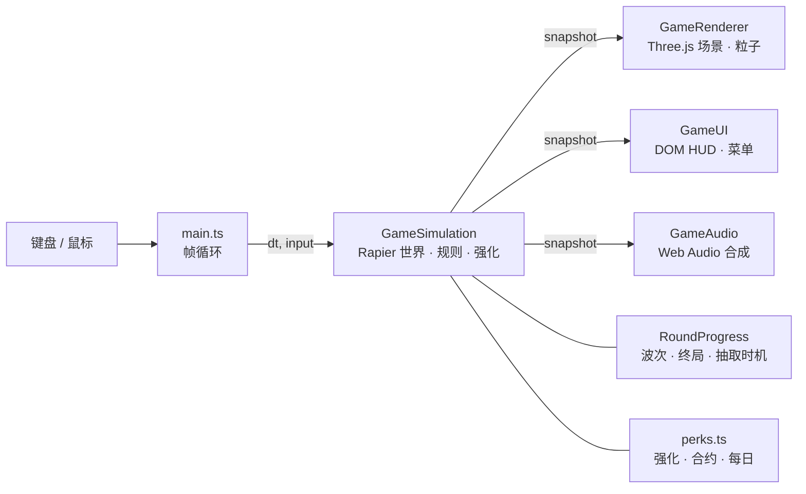

<div align="center">


# CRASH! 城市连锁

**一款浏览器街机游戏：冲进路口，把自己炸飞，再操控残骸去引发更大的连锁事故。**

灵感来自 *Burnout CRASH!*，用 Three.js 与 Rapier 物理从零重做。三座城市、23 种车型、四种规则、波间强化、合约与每日挑战。

[**▶ 在线试玩**](https://crash-city-breakers.vercel.app) · [特色](#特色) · [运行原理](#运行原理) · [开始游玩](#开始游玩) · [本地开发](#本地开发)

[English](README.md) · **简体中文**


</div>

<br>


<br>

## 值得一看的理由

| | |
|---|---|
| **每次碰撞都是真物理** | 23 种车、货箱、路灯、挂车和建筑全是 Rapier 刚体。巴士会侧翻是因为重心高，不是脚本安排。 |
| **每一局都不一样** | 一局三次强化抽取、可选合约、种子化奖励袋，外加每日修饰词。同一个种子就是同一局，直接分享挑战编号。 |
| **三种真实道路结构** | 旧金山的坡道十字路口、悉尼的错位 T 形路口、伦敦的环岛，车流走法各不相同。 |
| **没有后端** | 纯静态 Vite 构建。纪录、设置和涂装解锁都存在 `localStorage`，没有账号，不上传任何东西。 |

<br>

## 特色

### 先接合约，再在波间抽强化

<table><tr>
<td width="50%"></td>
<td width="50%"></td>
</tr><tr>
<td>出发前从三张<b>合约</b>里选一张（拆掉 3 座建筑、把连锁推到 ×18、零逃脱……）或者跳过。完成后一次性获得 25 万到 50 万美元，并多算一颗星。</td>
<td>每一波结束后从九种<b>强化</b>里抽三张选一张：更大的爆破半径、更重的弹头、更快的回充、余烬引信、更便宜的技能……选择时时间静止。</td>
</tr></table>

### 四种规则、三座城市、四辆玩家车

| 规则 | 限制 | 终局 |
|---|---|---|
| **Road Trip / 公路之旅** | 60 辆车分三波；五辆完整逃脱即结束 | 按路线触发灾难（龙卷风、空袭、巨浪），逃脱越少威力越强 |
| **Rush Hour / 高峰时刻** | 90 秒；逃脱不扣机会 | 在你的位置引发超级爆破，再等物理结算 |
| **Pile Up / 连环堆撞** | 30 辆车 | Inferno：燃烧的残骸延长倒计时，新的破坏延长更多 |
| **Sandbox / 自由连锁** | 120 秒，自选配装 | 三次手动机关（绿灯浪潮、货架倾落、广告牌倒塌） |

每座城市有三条入场路线和一个城市事件，在标记区制造碰撞即可充能。每辆玩家车都有一个 **Q 技能**：磁吸弹跳、三连穿刺、废铁投手或重锤封街。

### 带修饰词的每日挑战


当天日期固定城市、路线、车辆、规则和一个**修饰词**：油罐暴动、冰面路口、超速车流、玻璃大炮、月面重力或黄金车队。同一天的所有人拿到同一个种子。今日最佳与连续天数记录在本机。

### 落到实处的反馈

每次 Crashbreaker 引爆有 70 毫秒顿帧。连锁到 ×8 / ×16 / ×25 / ×40 时进入慢动作，弹出 `NICE CHAIN!` → `TOTAL CARNAGE!` 喊话，伴随冲击环和合成音效。连锁倍率徽章就在分数旁边。跨局累计的星星解锁六种车身涂装。


<br>

## 运行原理



模拟层持有全部状态，以固定 60 Hz 推进 Rapier。每帧发布一份不可变的**快照**，渲染器、HUD 和音频只读取它。随机数拆成多条种子流（车流、物理散落、奖励、抽取、修饰词），因此一个种子对应一局可复现的游戏，脚本化测试也永远不会弹出抽取面板。

<details>
<summary>项目结构</summary>

```
src/
├── main.ts                 帧循环、输入、持久化、顿帧
├── shared.ts               车辆表、路线、类型、种子随机数
├── cities.ts               三城布局、车道、事件区
├── i18n.ts                 中文 → English 文案表
├── simulation/
│   ├── GameSimulation.ts   Rapier 世界、碰撞、技能、事件
│   ├── roundProgress.ts    车流账本、波次、终局、抽取时机
│   ├── perks.ts            强化、合约、修饰词、每日种子、涂装
│   ├── rules.ts            计分、星星、纪录键
│   ├── trafficPlan.ts      种子化车流到达
│   └── bonusPlan.ts        种子化披萨奖励袋
├── render/                 Three.js 渲染器、程序化模型、涂装
├── ui/                     DOM HUD、车库、结算、车辆预览
└── audio/                  Web Audio 合成器
public/models/              由 scripts/build-assets.mjs 生成的 55 个 GLB
tests/                      Vitest：规则、物理、奖励、强化
scripts/                    资源构建 + Playwright 浏览器检查
```

</details>

<br>

## 开始游玩

### 在线试玩

用支持 WebGL 2 的桌面浏览器打开 **[https://crash-city-breakers.vercel.app](https://crash-city-breakers.vercel.app)**，无需安装。

### 操作

| 按键 | 作用 |
|---|---|
| `W A S D` / 方向键 | 入场转向；爆破后调整残骸落点 |
| 鼠标 + `Space` | 瞄准并在能量槽满时引爆 Crashbreaker |
| `Q` | 车辆技能（需要冷却结束并有足够能量） |
| `1` `2` `3` | 选择强化或合约 · `4` 跳过合约 |
| `Esc` / `R` | 暂停 / 按同样配置重开 |
| `E` + `1`–`3` | 仅 Sandbox：慢动作机关选择 |

### 本机运行

前置条件：**Node.js 22+** 和 npm。

```bash
git clone https://github.com/Olivia295/crash-city-breakers.git
cd crash-city-breakers
npm install
npm run dev
```

打开 <http://127.0.0.1:5173/>，应该能看到默认选中旧金山的车库界面。

> [!TIP]
> macOS 上可以不开终端：双击项目文件夹里的 **`开始游戏.command`**。它会自动安装、构建并打开游戏；关闭窗口即停止。

<br>

## 本地开发

<details>
<summary>构建、预览与测试</summary>

| 命令 | 作用 |
|---|---|
| `npm run dev` | Vite 开发服务器，`127.0.0.1:5173`，带 `window.__CRASH__` 调试钩子 |
| `npm run build` | 先 `tsc --noEmit`，再把生产包输出到 `dist/` |
| `npm run preview` | 在 `127.0.0.1:4173` 提供 `dist/` |
| `npm test` | Vitest：116 项测试，覆盖规则、刚体行为、奖励、强化与每日种子 |
| `npm run assets` | 重建 55 个 GLB 模型 |
| `npm run assets:previews` | 重新渲染 23 张车库缩略图 |
| `npm run test:cities` / `test:city-ui` / `test:language` | Playwright 流程（需要 Chrome；可用 `CHROME_PATH` 指定） |
| `npm run test:performance` | 完整 Rush Hour 一局的帧耗时实测 |

没有环境变量。浏览器脚本接受 `CRASH_URL` 指向其他服务器，以及 `CRASH_CITY=sf|sydney|london`。

</details>

<details>
<summary>部署</summary>

这是一个纯静态 Vite 站点。在 Vercel 导入仓库并接受自动检测的设置即可（构建 `npm run build`，输出 `dist`）。任何能托管 `dist/` 的静态服务都行。

</details>

<details>
<summary>数值调校</summary>

平衡数值与物理安全措施记录在 [`src/simulation/TUNING.md`](src/simulation/TUNING.md)。v0.2–v0.5 的中文变更说明在 [`docs/CHANGELOG-zh.md`](docs/CHANGELOG-zh.md)，原始参考研究在 [`REFERENCE-STUDY.md`](REFERENCE-STUDY.md)。

</details>

<br>

## 常见问题

<details>
<summary>页面提示城市未能装载。</summary>

游戏需要 WebGL 2。请使用最新的桌面版 Chrome、Edge、Firefox 或 Safari，并确认开启了硬件加速。

</details>

<details>
<summary>为什么 Sandbox 以外不能选爆破和被动配装？</summary>

三种参考规则锁定配装，保证纪录可比较。在这些模式里，局中抽取的强化就是你的构筑方式。

</details>

<details>
<summary>怎么分享一局？</summary>

结算页显示挑战编号（即种子）。任何人用同样的城市、路线、车辆、规则和这个种子，都会得到同样的车流、奖励和抽取选项。每日挑战会自动做这件事。

</details>

<details>
<summary>我的纪录存在哪里？</summary>

在浏览器的 `localStorage` 里，键为 `crash-city:world-tour-v3`。清除站点数据会抹掉它们；不会发送到任何地方。

</details>

<br>

## 致谢

向 *Burnout CRASH!*（Criterion Games）的路口撞车玩法致敬的原创作品。城市布局、车辆模型、技能、奖励、音效和全部代码都在本项目内制作，没有复制原作的任何内容。

<!-- TODO: 选择许可证并添加 LICENSE 文件 -->
